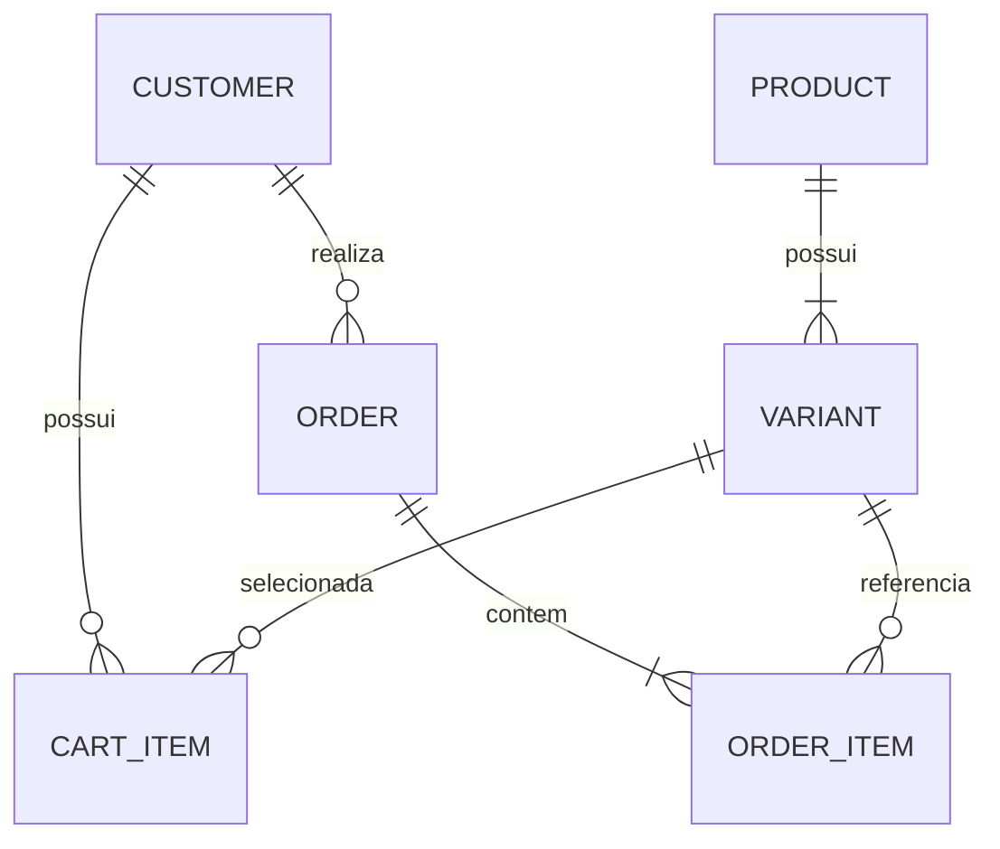

# SICKO DISTRICT

Loja de streetwear para apresentação acadêmica. Backend em ASP.NET Core 10 / C#, banco relacional SQLite com adaptador nativo do Windows, interface web e versão mobile PWA usando a mesma API e o mesmo banco.

## Executar no Windows

Requisito: Windows 10/11 e SDK .NET 10. Não exige SQL Server nem pacotes NuGet externos. O SQLite usa a biblioteca winsqlite3.dll fornecida pelo Windows.

No PowerShell, na pasta deste arquivo:

```powershell
powershell -ExecutionPolicy Bypass -File .\Iniciar.ps1
```

Abra **http://localhost:5080**. Mantenha o terminal aberto. Alternativa:

```powershell
$env:ASPNETCORE_ENVIRONMENT = 'Development'
dotnet run --urls http://localhost:5080
```

O banco `sicko.db` é criado automaticamente na primeira execução, com seis produtos e variantes P, M, G e GG. Os dados permanecem ao reiniciar. A criação usa DDL SQL (`CREATE TABLE IF NOT EXISTS`); mudanças posteriores no esquema exigem scripts de migração ou um novo banco de demonstração. Faça cópia do banco antes de qualquer reinicialização de dados.

## Contas

Administrador local, criado apenas em ambiente Development:

- E-mail: `admin@sicko.local`
- Senha: `District@2026`

Cadastre uma conta de cliente na interface. As senhas são armazenadas com hash do PasswordHasher do ASP.NET Core. A conta de demonstração não deve ser usada em uma publicação pública.

## Funcionalidades

- Vitrine responsiva, filtros por categoria, pesquisa, ordenação e seleção de tamanho.
- Cadastro, login e logout com cookie HttpOnly e SameSite Strict.
- Carrinho persistido por usuário, compartilhado pelos acessos à mesma conta.
- Checkout com endereço e pagamento explicitamente simulado, sem cobrança.
- Histórico de pedidos do cliente.
- Administração de produtos, preços, descrição, ativação e estoque por tamanho.
- Painel com métricas, clientes e atualização do status de pedidos.
- Cancelamento com reposição de estoque e preservação do histórico.
- Proteção CSRF, autorização no servidor e limite de tentativas de login/cadastro.

As imagens de produto são ilustrações SVG locais criadas para o projeto. O painel permite escolher entre camiseta, moletom e calça. Não há upload de fotos, recuperação de senha, frete real ou integração bancária nesta versão.

## Mobile

A versão mobile é uma **PWA responsiva**, não um APK nativo. Use o navegador do celular e, quando disponível, “Instalar aplicativo” ou “Adicionar à tela inicial”. Catálogo, sacola e pedidos acessam o mesmo backend ASP.NET.

Em `localhost`, o navegador permite testar o service worker. Para instalar em um celular real, publique o projeto em um servidor ASP.NET com **HTTPS confiável**. `localhost` no telefone aponta para o próprio telefone. O acesso por IP da rede também exige configurar o endereço de escuta, `AllowedHosts` e firewall; HTTP por IP não garante a instalação da PWA. Não exponha a conta administrativa de demonstração na internet.

O shell estático pode abrir offline depois do primeiro acesso. Login, preços atuais, carrinho e compras exigem conexão e não são armazenados no cache do service worker. Fontes Google têm fallback local sem internet.

## Roteiro para apresentar

1. Abra a vitrine e mostre a identidade visual, categorias e busca.
2. Cadastre um cliente, escolha tamanho e adicione duas unidades à sacola.
3. Finalize com um endereço fictício e mostre o pedido confirmado.
4. Saia e entre como administrador. Mostre o pedido e o estoque reduzido.
5. Altere o pedido para Preparando e depois Enviado. Use outro pedido para demonstrar o cancelamento e a devolução de estoque.
6. Edite um produto no painel e mostre a alteração na vitrine.
7. Reduza a largura do navegador para mostrar a interface mobile.
8. Reinicie o servidor para demonstrar a persistência dos dados.

## Teste de integração

Com o servidor em execução e Node.js 20 ou superior instalado:

```powershell
node Testar.mjs
```

O teste verifica permissões, estoque, total, pedido duplicado sequencial, isolamento de clientes, cancelamento, transições e CSRF. Cria contas de teste e um pedido cancelado. Não é um teste de carga nem prova exaustiva de concorrência.

## Organização

- `Program.cs`: API, autenticação, autorização, transações e dados iniciais.
- `Models.cs`: entidades.
- `Database.cs`: SQL de criação, consultas parametrizadas e persistência transacional SQLite.
- `wwwroot/`: site, estilos, JavaScript, manifesto e service worker.
- `appsettings.json`: conexão com SQLite, configurável por `ConnectionStrings__Store`.

## API principal

| Método | Endpoint | Acesso |
|---|---|---|
| GET | `/api/session` | Público, emite token CSRF |
| POST | `/api/register`, `/api/login`, `/api/logout` | Token CSRF |
| GET | `/api/products` | Público |
| GET | `/api/me`, `/api/cart`, `/api/orders` | Cliente autenticado |
| PUT | `/api/cart` | Cliente autenticado + CSRF |
| POST | `/api/checkout` | Cliente autenticado + CSRF |
| GET | `/api/admin/overview`, `/products`, `/orders`, `/customers` | Administrador |
| POST | `/api/admin/products` | Administrador + CSRF |
| PUT | `/api/admin/products/{id}` | Administrador + CSRF |
| PUT | `/api/admin/orders/{id}/status` | Administrador + CSRF |

Os caminhos abreviados na linha de administração usam o prefixo `/api/admin`. A API usa cookies de mesma origem; esta versão não inclui JWT nem Swagger.

## Regras e arquitetura

O servidor calcula os totais usando `decimal`. Cada item de pedido guarda nome, tamanho e preço da compra. Cada unidade de trabalho abre uma transação SQLite com `BEGIN IMMEDIATE` antes da leitura. Isso serializa as operações entre conexões e impede que duas compras confirmem o mesmo estoque. O carrinho é removido na mesma transação de criação do pedido. O adaptador carrega os dados em memória e grava um snapshot relacional atômico, uma escolha simples para o volume pequeno deste trabalho. Não é uma arquitetura para alto volume de usuários.

Estados permitidos: Confirmado → Preparando → Enviado → Entregue. Confirmado e Preparando podem virar Cancelado. Cancelado e Entregue são finais.



Categoria é um campo do produto; endereço e pagamento demonstrativo são snapshots do pedido. As relações entre usuários, variantes, carrinhos, pedidos e itens possuem chaves estrangeiras no SQLite. E-mails e pares usuário/variante no carrinho têm restrição de unicidade. O estoque tem restrição para impedir valores negativos.
